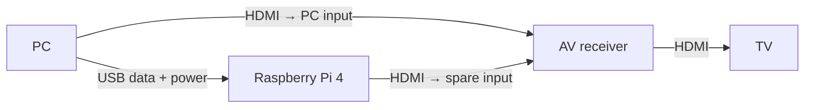

# pi-cec

Automatically turn on your TV and AV receiver when your PC wakes, select the
PC's HDMI input, and put them into standby when the PC sleeps.

`pi-cec` runs on a Raspberry Pi 4. It detects sleep and wake through the PC's USB
bus and controls the AV system over HDMI-CEC. No companion software needs to be
installed on the PC, and normal operation requires no network connection.

## How it works

The Pi connects to the PC over USB and to a spare HDMI input on the receiver.
The PC's video output remains connected to its existing receiver input.



- **PC wakes:** turn on the TV and receiver, then select the PC input.
- **PC sleeps:** wait through a configurable debounce period, check source
  ownership, then send standby if the PC still owns the session.
- **Another source takes over:** yield to it instead of repeatedly selecting
  the PC. Standby behavior depends on the configured ownership policy.

The Pi acts as a CEC proxy for the PC's HDMI address so the receiver selects
the PC input. Video never passes through the Pi, so it adds no constraints to
the video connection's resolution, refresh rate, or HDR support.

Any existing wake method can be used, provided it resumes the USB connection
to the Pi. `pi-cec` responds to that transition; it does not wake the PC itself.
Manual and automatic sleep are handled through the same USB event detection.

## Requirements

- Raspberry Pi 4 running Linux with systemd, USB gadget support, and native
  Linux CEC support.
- A USB data cable from the PC to the Pi's **USB-C port**.
- A micro-HDMI cable from the Pi to a spare receiver input.
- A TV and receiver with HDMI-CEC enabled.
- Enough USB power to keep the Pi running while the PC sleeps.

Power availability varies by PC port and sleep state. Check for undervoltage
and unexpected Pi reboots during setup. Never connect PC USB power and a second
Pi supply in parallel.

## Build and install

Build on the Pi with Rust, a C compiler, and Linux CEC headers. For example,
on Ubuntu or Debian:

```sh
sudo apt update
sudo apt install git cargo rustc build-essential linux-libc-dev v4l-utils

git clone https://github.com/michaelhenkel/pi-cec.git
cd pi-cec
cargo test --all-targets
cargo build --release

sudo ./target/release/pi-cec inspect
sudo ./target/release/pi-cec install
```

Requires Rust 1.74 or newer. The application is written in Rust with no Cargo
dependencies and a small C shim for the Linux CEC interface.

The installer adds the executable, configuration, and systemd services. It
starts power logging; AV control stays disabled until setup is complete.

Follow the [setup guide](docs/commissioning.md) to configure USB peripheral
mode, measure both HDMI physical addresses, and install the Pi's CEC proxy
identity. These addresses depend on your HDMI connections, so they must be
measured for your setup.

After validating power, USB sleep/wake events, and input selection, update
`/etc/pi-cec/pi-cec.conf`, including its verification fields and tested kernel
version. Enable automatic operation:

```sh
sudo pi-cec --check
sudo pi-cec enable-live
```

Once enabled, the services start automatically on Pi boot and run unattended.

## Configuration

Settings live in `/etc/pi-cec/pi-cec.conf`. See the
[default configuration](config/pi-cec.conf) for all options.

| Setting | Purpose |
| --- | --- |
| `pc_pa`, `pi_pa` | Measured physical addresses of the PC and original Pi HDMI inputs |
| `on_debounce_ms`, `off_debounce_ms` | Filter brief USB transitions before taking action |
| `standby`, `standby_policy` | Enable standby and choose how PC source ownership is established |
| `startup_select_pc` | Check routing and select the PC after fresh USB enumeration at Pi startup |
| `tv_always_receiver` | Handle a TV that always uses the receiver input; excludes TV apps from ownership protection |
| `power_scope` | Require continuous power, or accept Pi restarts outside ordinary sleep/wake |

Restart the daemon after editing its configuration:

```sh
sudo systemctl restart pi-cec
```

## Diagnostics

```sh
sudo pi-cec inspect                            # Hardware and boot configuration
systemctl status pi-cec                        # Service status
journalctl -u pi-cec -f                        # USB events and CEC messages
sudo pi-cec power-report /var/lib/pi-cec/power.log
```

To inspect behavior without sending CEC commands, stop the service and run in
dry-run mode. Press Ctrl+C when finished, then start the service again.

```sh
sudo systemctl stop pi-cec
sudo pi-cec --dry-run
sudo systemctl start pi-cec
```

## Compatibility

- **Display timeout is separate from PC sleep.** Turning off the display alone
  does not suspend the USB bus or trigger AV standby.
- **USB events depend on the host.** An OS suspending an idle USB device can
  look like PC sleep. Background wake can look like user wake.
- **Hibernate may interrupt Pi power.** USB power can behave differently during
  sleep, hibernate, and shutdown. With `startup_select_pc=true`, the Pi checks
  routing after it boots and the PC enumerates the USB device.
- **Source protection depends on CEC messages.** A silent receiver input change
  may be undetectable. The default `fresh` standby policy skips standby without
  positive routing evidence; other policies are explained in the setup guide.
- **Kernel updates need revalidation.** USB tracing uses kernel callbacks;
  live mode requires the configured kernel version to match the running one.

## Uninstall

```sh
sudo systemctl stop pi-cec
sudo pi-cec prepare-boot --remove
sudo pi-cec uninstall
sudo reboot
```

Managed configuration is restored from backups. Logs and backup files are
retained.

## License

[MIT](LICENSE).
